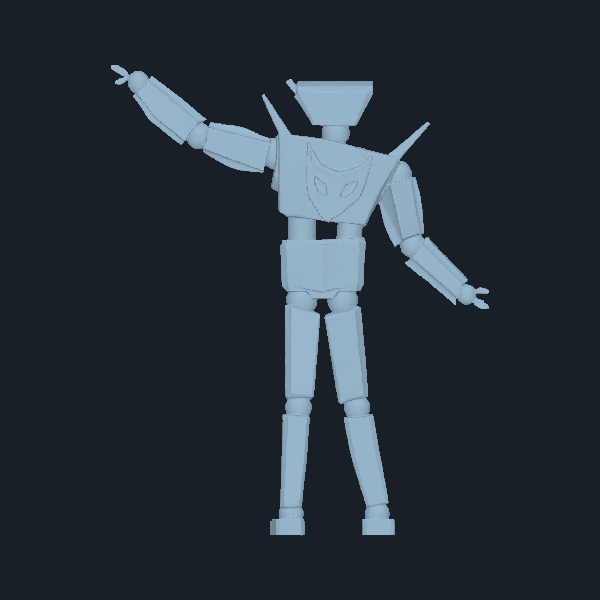
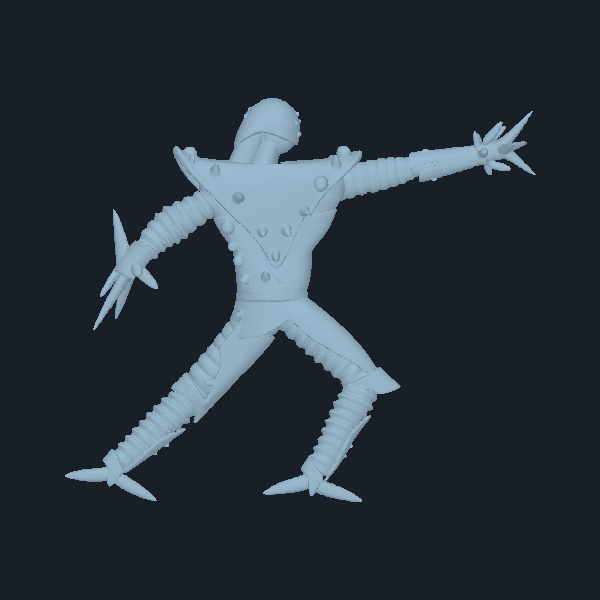

# Imported mesh candidates

These are the two user-supplied Meshy FBX exports. They are **candidate source
meshes**, not approved Jaguar or Shadow models. The FBX files have been left
untouched. The images below are neutral geometry previews rendered locally;
their gray color is only preview lighting. The files do not declare which side
is the character's front, so the preview labels describe the camera projection.

| File | Geometry | Preview | Current assessment |
| --- | --- | --- | --- |
| [Blue Robot Mascot](Meshy_AI_Blue_Robot_Mascot_1014010749_generate.fbx) | 42,595 vertices; 85,194 triangles | [straight-on](previews/robot-mascot-front.png), [three-quarter](previews/robot-mascot-three-quarter.png) | **Jaguar concept only.** Angular torso and three-prong hands are useful shape exploration. Helmet, chest, proportions, and pose do not match the [approved Jaguar views](../../robots/jaguar/canonical/README.md). |
| [Blue Rocket Jester](Meshy_AI_Blue_Rocket_Jester_1014011155_generate.fbx) | 101,907 vertices; 204,050 triangles | [straight-on](previews/rocket-jester-front.png), [three-quarter](previews/rocket-jester-three-quarter.png) | **Shadow concept only.** Spiked limbs and angular torso could inform exploration, but its shape and spread pose do not match the [approved Shadow views](../../robots/shadow/canonical/README.md). |

Both FBX files contain one mesh object and no FBX skeleton/deformer, animation
stack, material, texture, or UV data. Their front width is about four times
their depth, so side-view volume should be checked before any use in the fight
camera. They need redesign against the canonical three-view references,
retopology or separation into moving parts, a rig, and animation before they
can serve as playable HARs. Their high triangle counts also warrant a simpler
runtime mesh and separate source mesh if adapted.

The identity decisions above describe their closest design association; they
do not establish the generator's intent or approve either FBX for production.
Record Meshy asset terms/provenance before moving an adapted version into a
distributable game package. The [original pose gallery](../OMF2097/poses/index.md) and
[higher-resolution Remastered captures](../Remastered/README.md) remain motion
and silhouette references alongside the approved OMF3K model views.

## Trying the Meshy meshes in the prototype

The full import process and its pitfalls are in [IMPORT_PROCESS.md](IMPORT_PROCESS.md).

`py -3 omf3k/tools/generate_meshy_meshes.py [--debug <dir>]` splits the
Robot Mascot (Jaguar) and Rocket Jester (Shadow) into the prototype's rig groups by
nearest bone, stands the spine up and hangs the arms and legs in the blockout rest
pose, decimates by vertex clustering (about 20k triangles) and
writes `omf3k/prototype/meshy_meshes.h`. After rebuilding `omf3d_prototype`, set
`OMF3K_MESHY=1` to render it in place of Jaguar's blockout, for example with
`--model-preview-capture`. Without the variable the blockout is used.

Dark ball joints at the shoulders, elbows, wrists, hips, knees and ankles cover
the seams where limbs rotate, and the body is rescaled to the blockout's joint
heights, and each head keeps its own shape, uniformly scaled to the blockout head's measured
width and placed where the blockout's head starts (read from `model_meshes.h`). Body width and depth are scaled by the
ratio of blockout to mesh size for the thighs (legs) and upper arms (torso level),
interpolated by height so the groups stay joined.

Vertices within a short band of each joint also follow the neighbouring rig group
(`ModelBlend` in the generated header, weight 0.5 at the joint fading to 0), so
limbs bend without cracks, and each rig group has its own color.

Known gaps: jagged clustering edges remain; the front is -Y (taken from the toe direction of the feet), so
`FRONT_SIGN` in the script is a guess to be flipped if the chest faces
backward.
