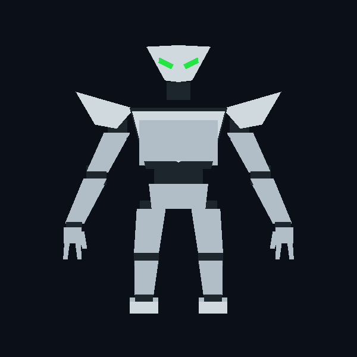
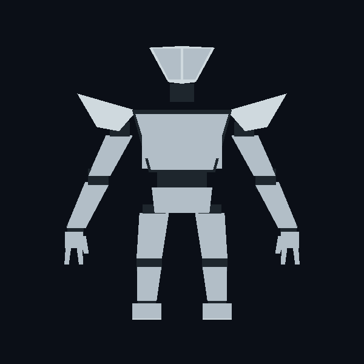
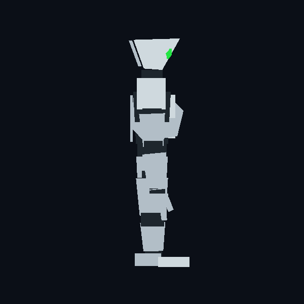
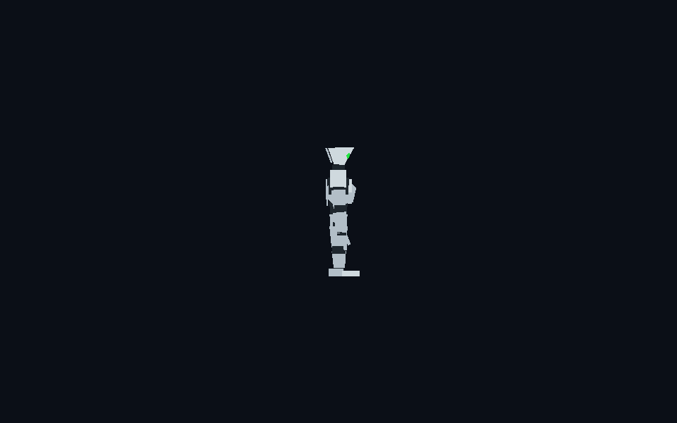

# Jaguar editable silhouette blockout

The [glTF model](jaguar-blockout.gltf) is a standalone, editable first pass
derived from the [approved Jaguar front, back, and side views](../canonical/README.md).
It contains 48 named mesh parts and 608 triangles. The [generator](build.py)
records the dimensions and keeps the model reproducible. Import the glTF into a
3D editor to move or reshape its individual parts. The
[rigged glTF](jaguar-rigged.gltf) contains a rigid joint hierarchy and eight
editor preview clips: idle, walk, jump, guard, punch, kick, hit, and signature.
The prototype moves these rigid parts with source-sprite poses. This is not a
skinned deformation rig.

| View | Render |
| --- | --- |
| Front |  |
| Back |  |
| Right side |  |
| Fight camera scale |  |

The model uses the prototype's Y-up coordinate system, with negative Z toward
the opponent. Its 3.34-unit height projects to about 183 pixels at the source
replay's 960×600 fight camera. This render checks scale and side silhouette;
it is not a prototype integration capture. The
[match review](../../../docs/OMF2115_MODEL_MATCH_REVIEW.md) contains captures of
the model running in the prototype.

The front has a wedge helmet (flat crown, two front planes meeting at a centre ridge, narrow chin) with slanted green eyes, shoulder fins, chest wedge,
and a small emblem marker. The back has two separate helmet panels with one
central seam and no face or emblem. Each hand has two fingers and one thumb.
The side view keeps a forward brow, distinct chest and foot projections, and
visible shoulder, elbow, hip, knee, and ankle breaks.

## Review gate

The user accepted this silhouette blockout for the prototype milestone on
2026-10-14. This acceptance covers the simple model shape at fight distance;
it does not establish final surface detail or animation polish.

Compare these renders directly with the canonical three-view set. At fight
distance, check the helmet and shoulder outline, body width, and toe direction
before adding smaller panel detail. Current limits: the straight neutral pose
and simplified flat colors omit the approved surface detail, and the hands
are too small to read at match distance. The runtime rig uses source-matched
poses from the
[original](../../../docs/OMF2097/poses/jaguar/index.md) and
[Remastered](../../../docs/Remastered/poses/jaguar/index.md) captures. A
final skinned armature and source-timed animation clips remain future asset work.

Rebuild: `py -3 project/robots/jaguar/blockout/build.py` from the repository root.
Run `py -3 project/robots/build_rigged.py` to rebuild both rigid-joint glTFs.
