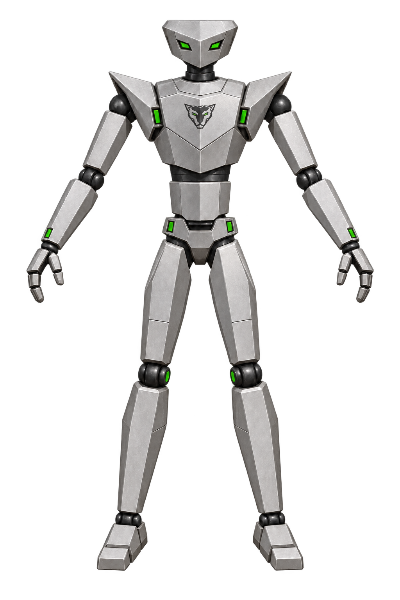
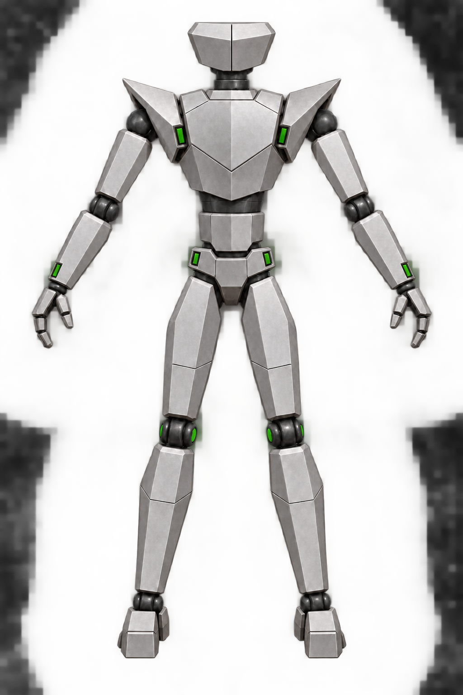
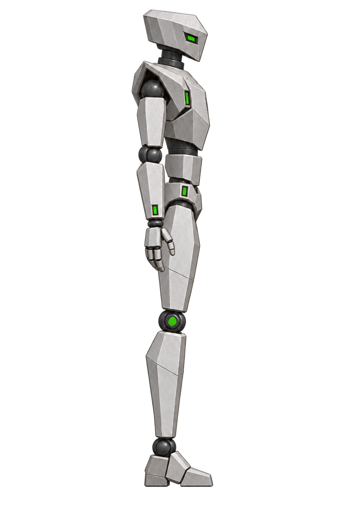

# Jaguar canonical 3D modeling reference

These three images are the approved visual reference for OMF3K's Jaguar 3D model. Use them as a matching front, back, and right-side set for silhouette, proportions, armor layout, materials, and color placement.

The [editable Jaguar silhouette blockout](../blockout/README.md) is the first
model candidate made from this reference set. Its shape has not yet been approved.

| View | Canonical image |
| --- | --- |
| Front |  |
| Back |  |
| Right side |  |

## Model lock

- Compact angular helmet with no antennas. The front has two narrow green eyes; the rear has exactly two broad panels divided by one center seam.
- Small stylized Jaguar head emblem centered on the upper chest. Do not place the face, eyes, or chest emblem on the back.
- Low angular shoulder armor, simple wedge chest and back, narrow waist, lean limbs, and blocky feet.
- Each hand has exactly three articulated digits total: two fingers and one opposable thumb-like digit. The same construction appears in the front, back, and side references.
- Satin silver-gray metal, dark joints, and sparse green accents. Align key joint heights and keep proportions consistent across all three views when building the mesh.
- The rear construction is an approved OMF3K interpretation; original game sprites remain the reference for recognizable motion and overall character identity.

The earlier [concept variants](../front/faithful-v2/README.md) record the design exploration. The previous front/back images are preserved in [history](history/), and earlier side drafts remain in the [side folder](../side/). New rig sheets, textures, and model files should reference this three-view set and link back here. Changes to an approved view should preserve a version and update this index deliberately.
