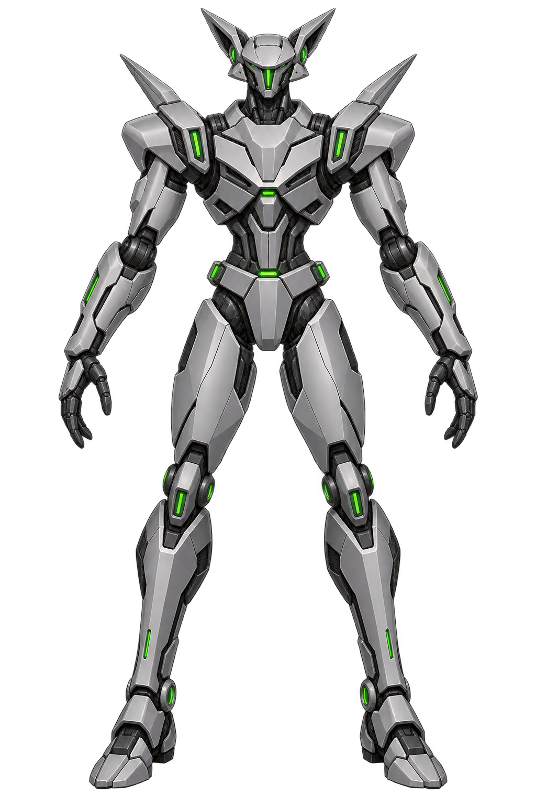
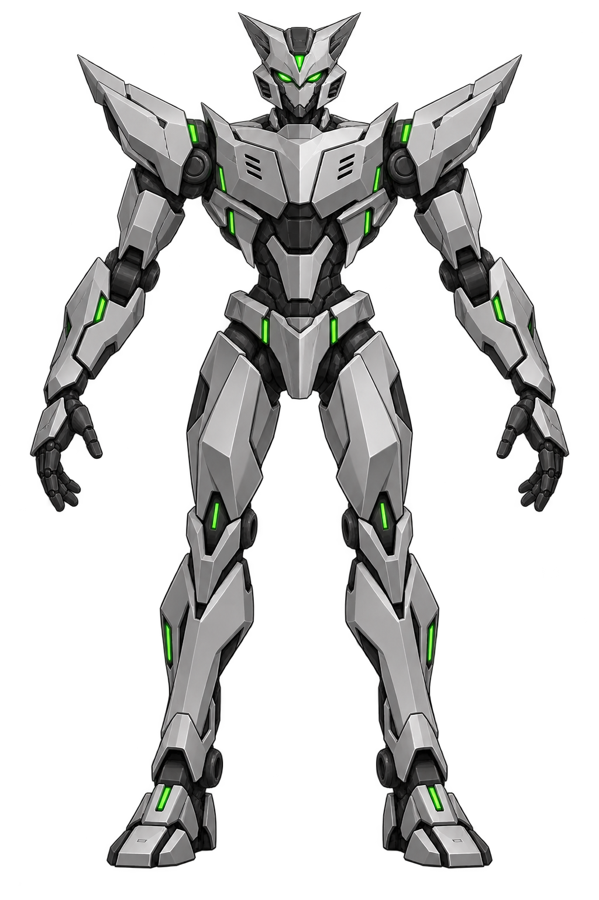
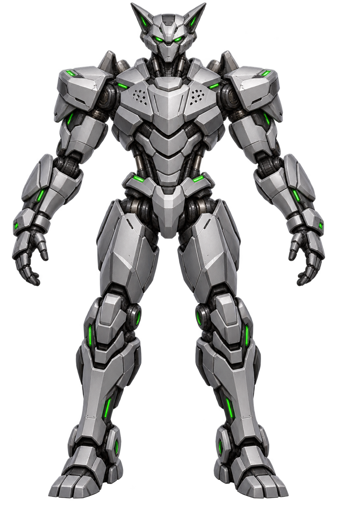
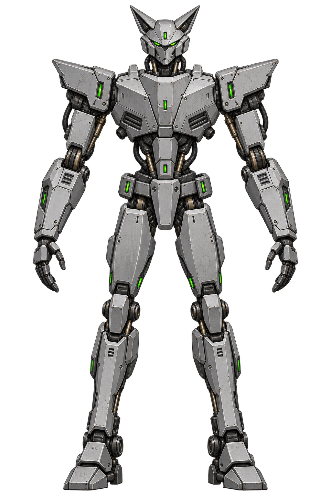
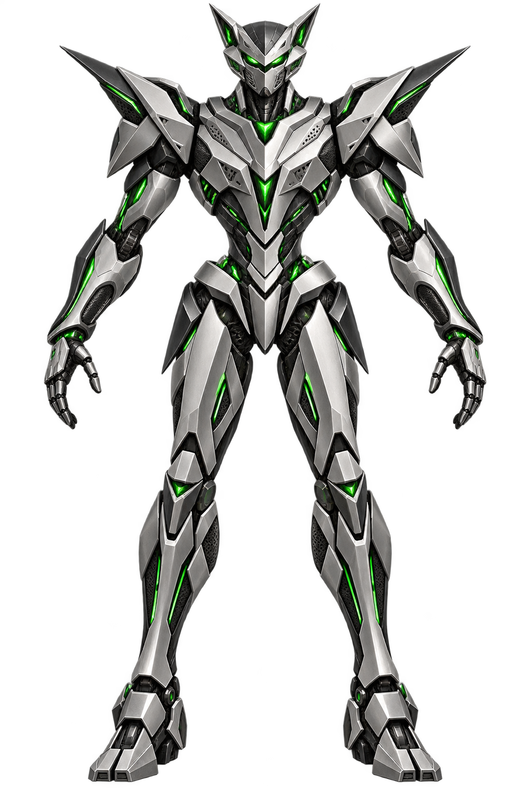

# Jaguar front-view redesigns

For designs closer to the original robot, see the [five faithful revisions](faithful-v2/README.md).

Five image-to-image concept variants based on Jaguar's original mostly frontal
victory frame and idle sprite from `FIGHTR0.AF`. Each asks for a full-body,
orthographic front view in a neutral pose, with silver-gray armor, green optics,
angular feline head shapes, broad shoulders, and a transparent background.

| Version | Direction | Image |
| --- | --- | --- |
| 1 | Faithful remaster: preserve the original proportions and silhouette while clarifying layered armor and joints |  |
| 2 | Sleek striker: lighter, sharper armor and a faster athletic silhouette |  |
| 3 | Heavy champion: reinforced chest, shoulders, gauntlets, and leg protection |  |
| 4 | Retro industrial: stamped plates, fasteners, pistons, access panels, and subtle wear |  |
| 5 | Elite prototype: refined ceramic-metal panels, tapered V-shaped chest, selective green circuitry |  |

These are exploration images. Before building a 3D model, choose one direction
and draw a consistent side, back, and three-quarter turnaround with matching
joint and armor construction.
