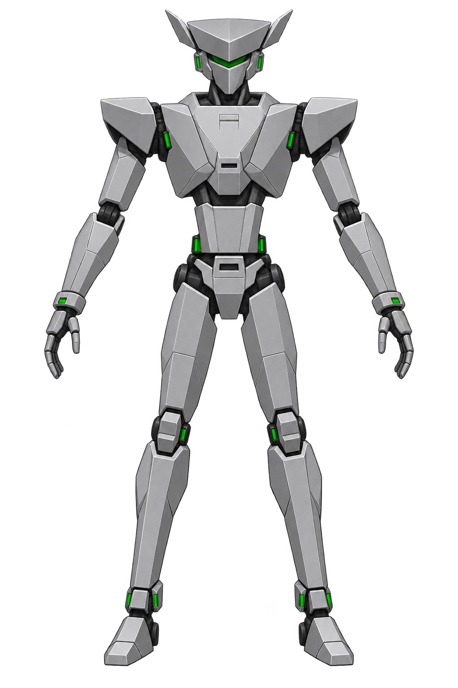
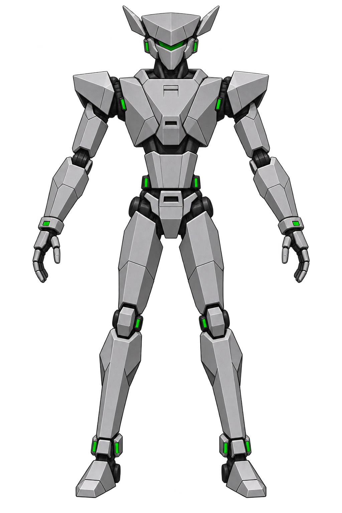
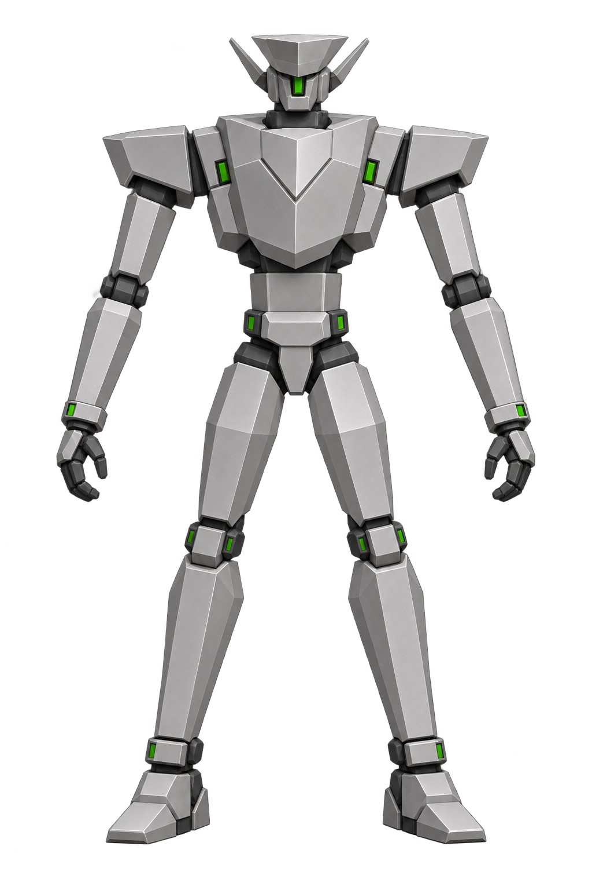
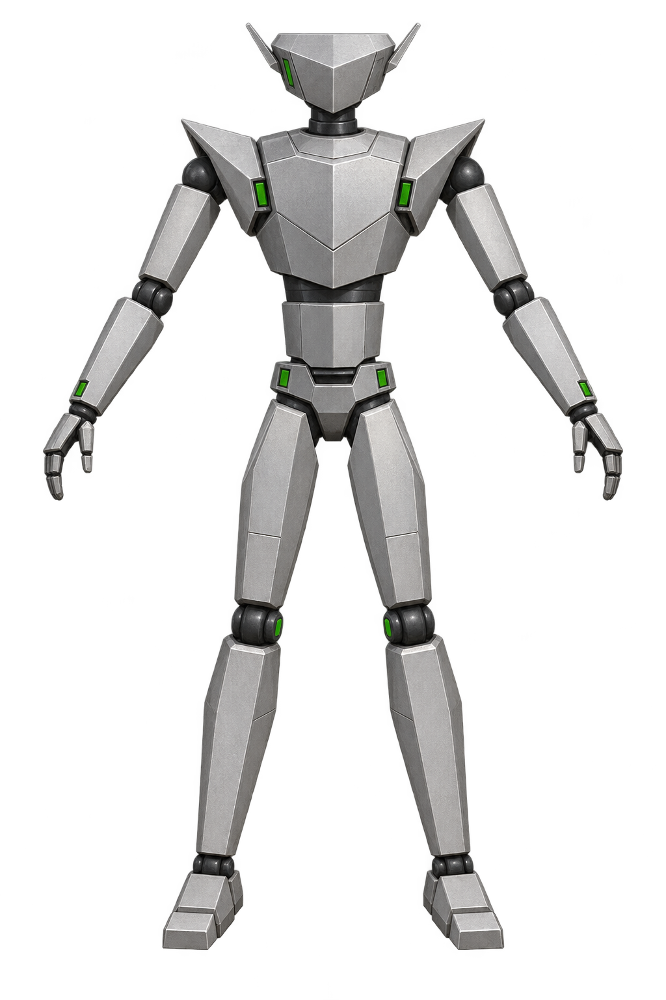
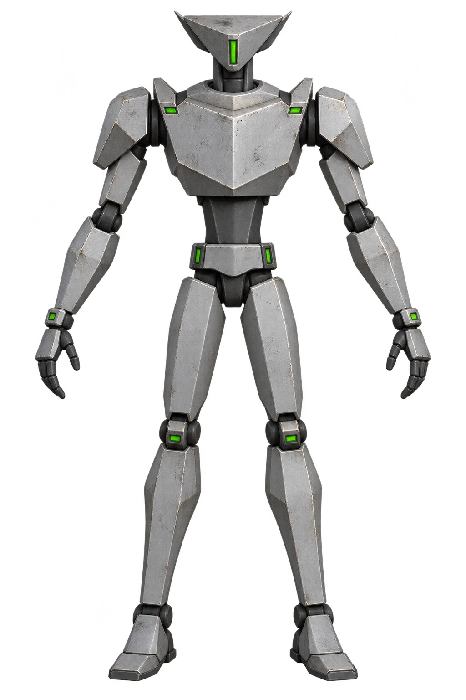
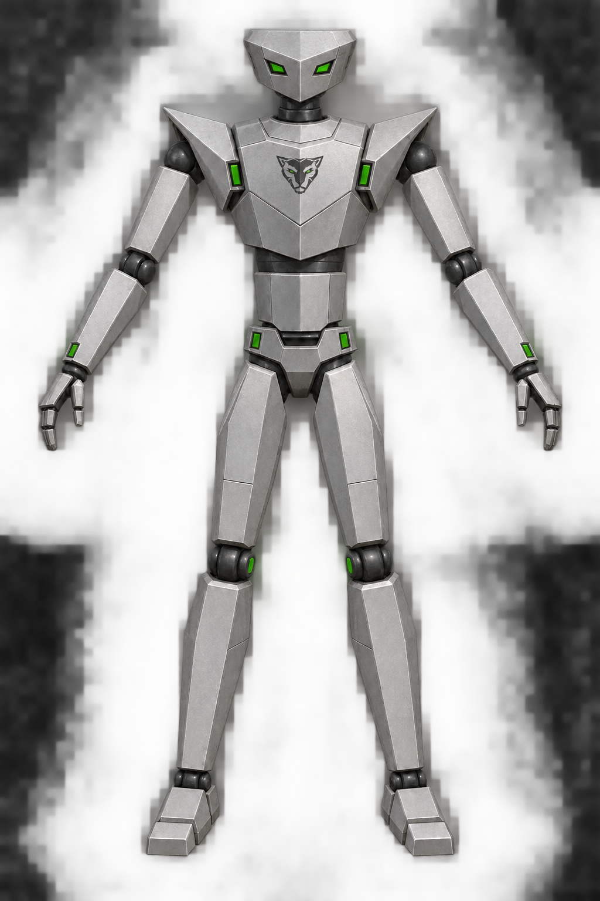
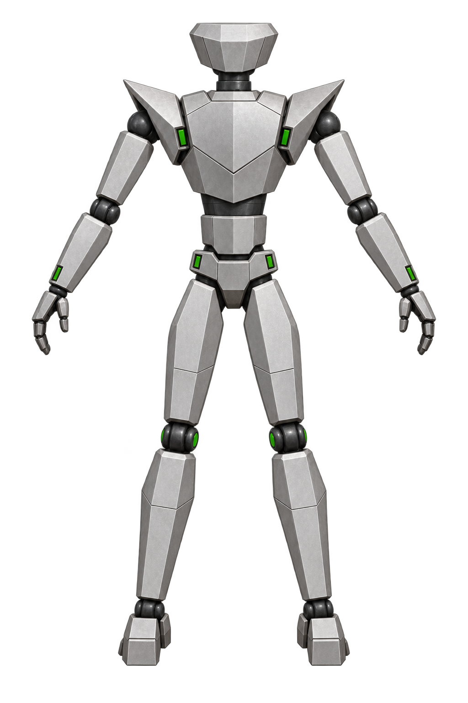
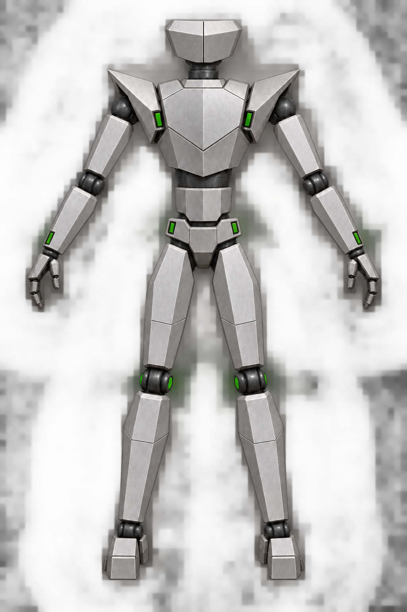

# Jaguar front view: faithful revisions

Five closer interpretations of the original *One Must Fall 2097* Jaguar robot. The [mostly frontal victory sprite](../../../../docs/OMF2097/poses/jaguar/12-victory.png) guided the shape; the [idle](../../../../docs/OMF2097/poses/jaguar/01-idle.png) and [punch](../../../../docs/OMF2097/poses/jaguar/07-punch.png) sprites provided supporting details.

The shared direction is a compact angular head with short fins, low shoulders, a simple wedge chest, narrow waist, lean limbs, silver-gray armor, dark joints, and restrained green accents. Each image shows a full-body frontal neutral pose. Differences focus on surface treatment and small construction details rather than a new silhouette.

| Version | Direction | Image |
| --- | --- | --- |
| 1 | Clean remaster |  |
| 2 | Slightly more angular classic armor |  |
| 3 | Faceted original-style model |  |
| 4 | Realistic satin metal |  |
| 5 | Lightly worn original-style armor |  |

## Selected revision

Version 4 with paired green eyes, a small stylized Jaguar head insignia on the chest, and no head antennas:

Matching rear view for modeling:

Updated rear view with the head simplified to two broad panels and one center seam:

The chest mark is a new stylized interpretation of a Jaguar insignia; the small source sprites do not resolve an exact emblem design.

These remain AI interpretations of tiny sprites, not definitive model sheets. After choosing a version, use the source sprites again when drawing side and back views so features are not invented by the image model.
