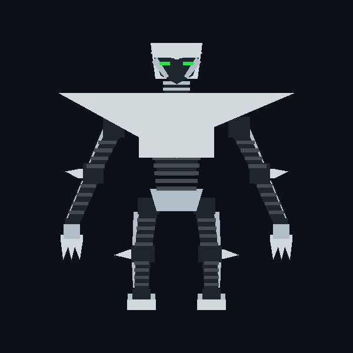
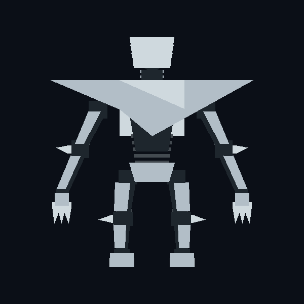
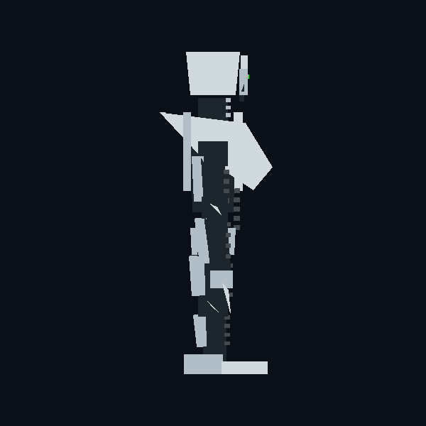
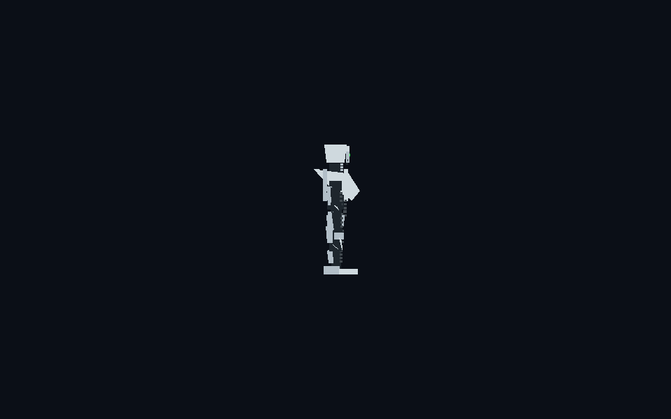

# Shadow editable silhouette blockout

The [glTF model](shadow-blockout.gltf) is a standalone, editable first pass
derived from the [approved Shadow front, back, and side views](../canonical/README.md).
It contains 99 named mesh parts and 1,160 triangles. The [generator](build.py)
records the dimensions and keeps the model reproducible. The same mesh source
feeds the prototype's generated render data. The
[rigged glTF](shadow-rigged.gltf) adds a rigid joint hierarchy and eight editor
preview clips: idle, walk, jump, guard, punch, kick, hit, and signature.

| View | Render |
| --- | --- |
| Front |  |
| Back |  |
| Right side |  |
| Fight camera scale |  |

The front has a featureless recessed face void with two green eyes, one
inverted shoulder and chest plate, ribbed dark limb cores, paired elbow and
knee spikes, and three rigid hand spikes. The back has a matching plate with
no face or chest light. A separate side-profile wedge gives the chest plate a
visible front and rear projection at the side-on fight camera.

The model uses the prototype's Y-up coordinate system, with negative Z toward
the opponent. It is a rigid-part blockout, not a skinned final model. See the
[match review](../../../docs/OMF2115_MODEL_MATCH_REVIEW.md) for what the runtime
pose rig and recorded match demonstrate and where they still differ.

The user accepted this silhouette blockout for the prototype milestone on
2026-10-14. Surface detail and animation polish remain open.

Rebuild: `py -3 project/robots/shadow/blockout/build.py` from the repository root.
Run `py -3 project/robots/build_rigged.py` to rebuild both rigid-joint glTFs.
