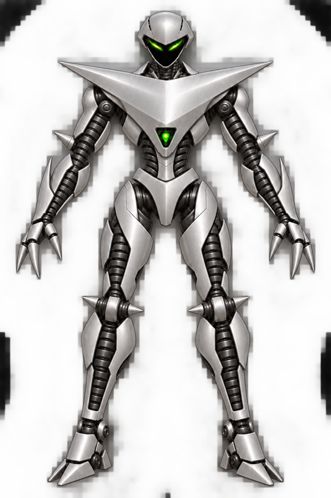
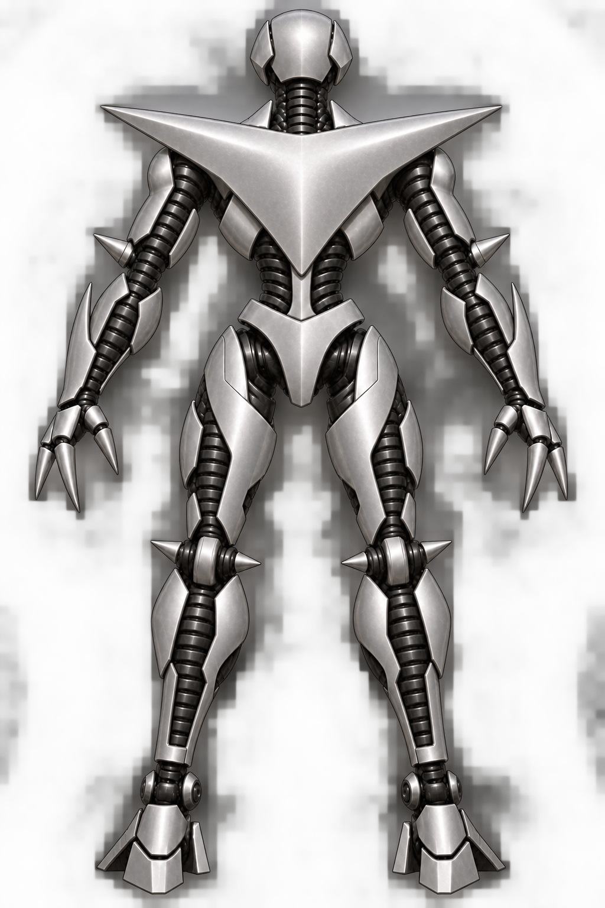
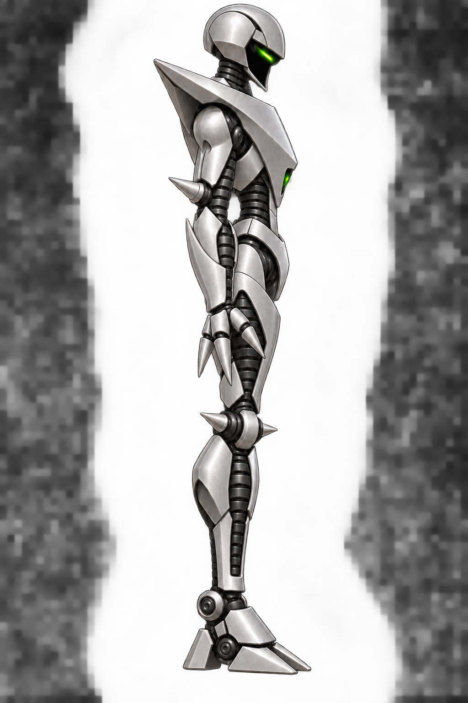

# Shadow canonical 3D modeling reference

These are the approved front, back, and right-side visual references for OMF2115's Shadow 3D model. Use this three-view set for proportions, silhouette, armor layout, material, and color placement.

The [editable Shadow silhouette blockout](../blockout/README.md) is the first
model candidate made from this reference set. It remains open to visual review.

| View | Canonical image |
| --- | --- |
| Front |  |
| Back |  |
| Right side |  |

## Model lock

- Compact silver helmet; narrow green eyes float in a recessed, featureless black opening on the front. There is no physical mouth, nose, or chin plate. The rear of the helmet remains solid silver.
- One broad continuous inverted triangular chest-and-shoulder plate with pointed outer shoulder tips and a small green light near the lower center. The back has a matching sharp triangular upper-back plate without the front light.
- Dark cylindrical ribbed mechanical structure runs along the arms, waist, and legs, framed by silver side armor. Keep the front and rear construction aligned at the shoulders, elbows, hips, knees, and ankles.
- Each hand ends in three rigid tapered metal spikes rather than articulated human fingers. Small mirrored spikes project from both elbows and knees.
- Satin silver-gray armor, dark joints, restrained green accents, robust but agile proportions, and angular feet.

The earlier [front concepts and revisions](../front/README.md) show the design process. The previous front image is preserved in [history](history/), and earlier side drafts remain in the [side folder](../side/). The [original Shadow sprites](../../../docs/OMF2097/poses/shadow/index.md) remain reference material for recognizable movement and character identity. New rig sheets, textures, and models should link back to this three-view set. Changes to an approved view should preserve a version and update this index deliberately.
