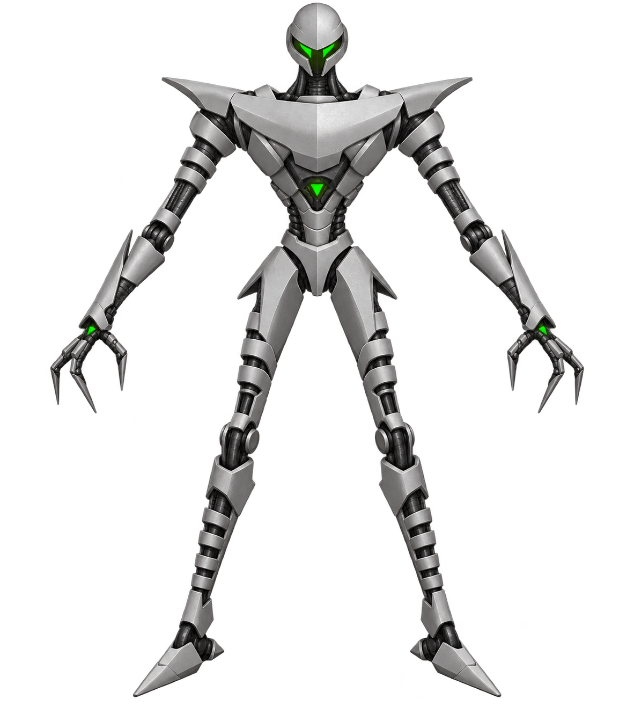
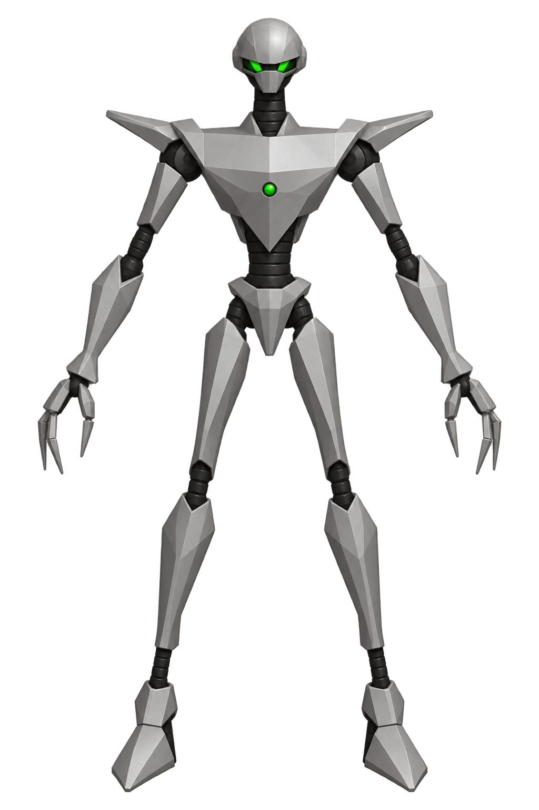
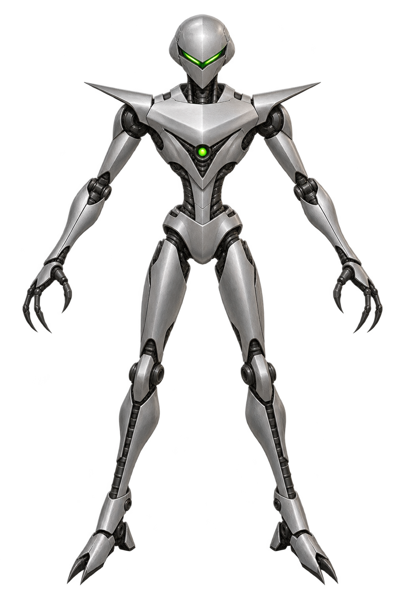
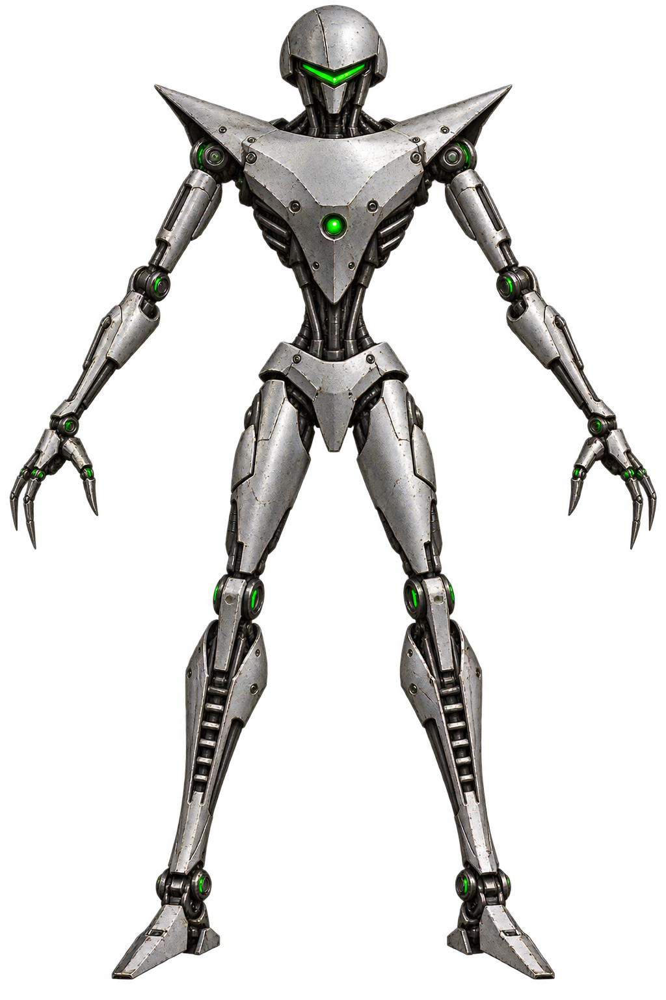
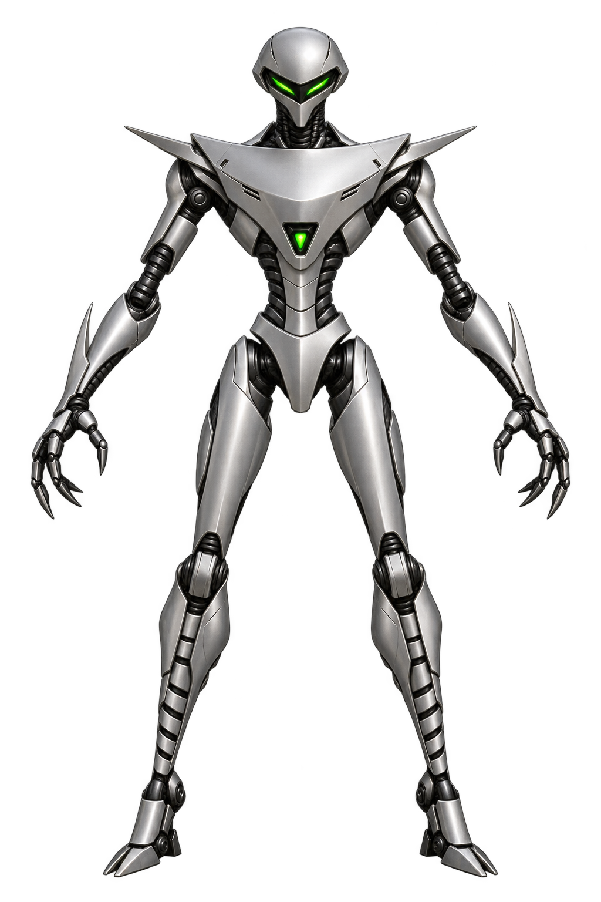
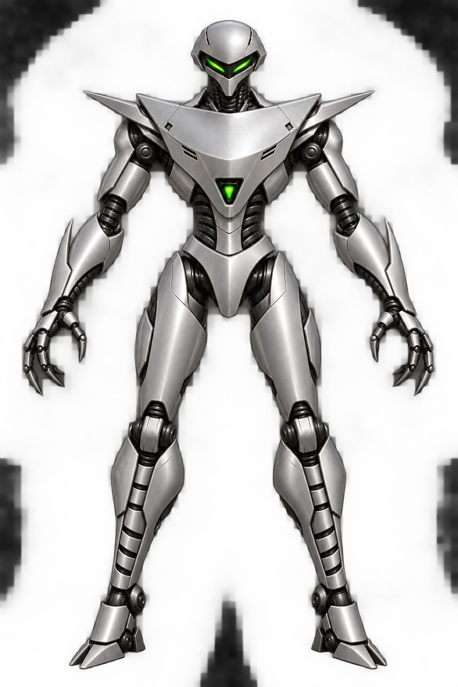
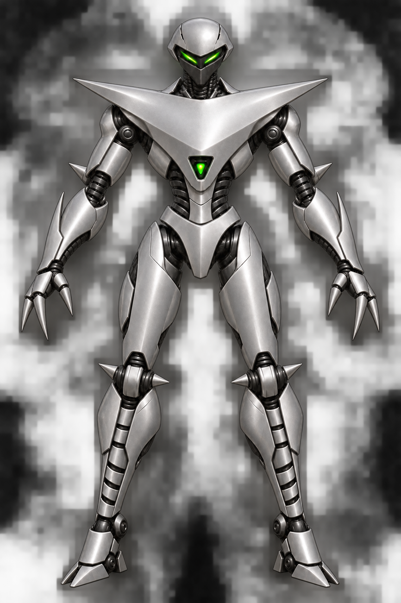
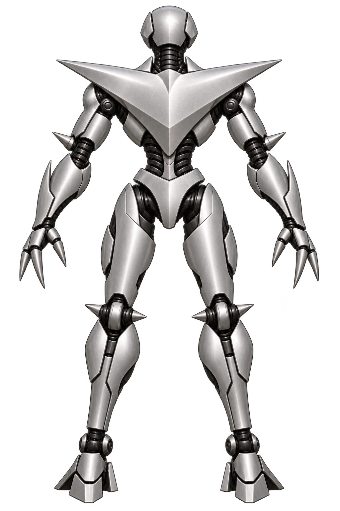
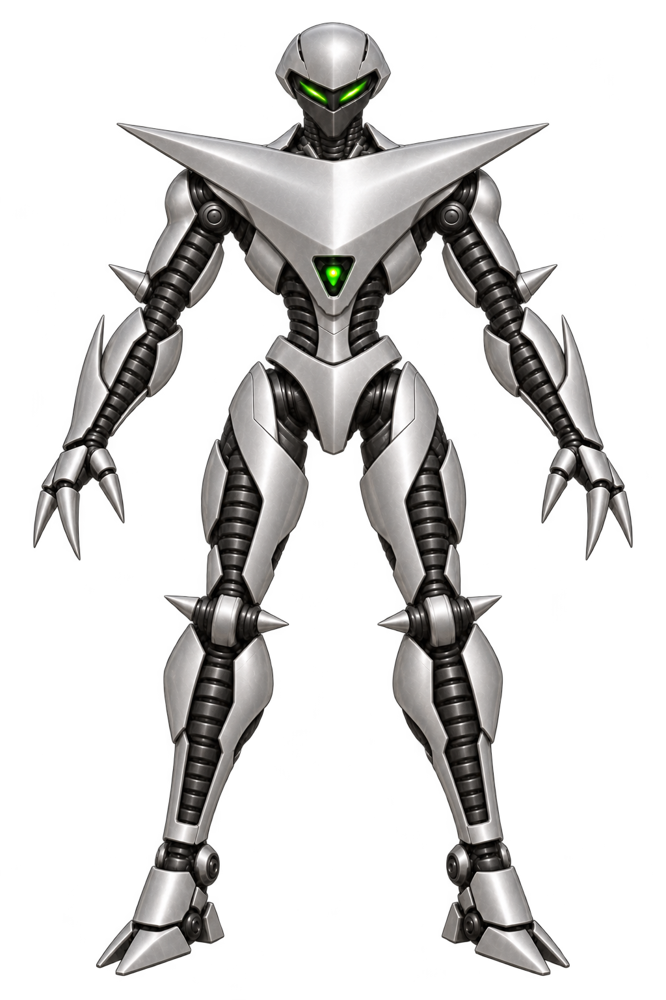

# Shadow front-view redesigns

The selected final front and back pair is now recorded as Shadow's [canonical OMF3K modeling reference](../canonical/README.md).

Five improved Shadow concepts for OMF3K 3D modeling, generated from the original *One Must Fall 2097* Shadow [idle](../../../docs/OMF2097/poses/shadow/01-idle.png), [victory](../../../docs/OMF2097/poses/shadow/12-victory.png), [punch](../../../docs/OMF2097/poses/shadow/07-punch.png), and [special](../../../docs/OMF2097/poses/shadow/14-special.png) sprites.

All five explore a frontal neutral pose and retain Shadow's slim frame, compact silver head with green visor, swept shoulders, small green chest light, long limbs, and claw-like hands. They are concepts, not yet an approved modeling reference.

| Version | Direction | Image |
| --- | --- | --- |
| 1 | Detailed remaster: clarified layered plates and joints |  |
| 2 | Faceted classic: simple low-poly shapes closest to the source's 1990s construction |  |
| 3 | Streamlined: smoother armor emphasizing speed |  |
| 4 | Retro industrial: stamped plates, practical joints, light wear |  |
| 5 | Tournament polish: refined silver finish and precise joints |  |

## Version 5 revision

The selected fifth design with a fuller chest, thicker arm armor, stronger thighs and shins, and sturdier feet, guided by the original Shadow sprites:

Further revision: dark lower-face mask, one continuous triangular chest-and-shoulder plate, spiked hands, and small elbow and knee spikes.

Matching [rear view](../back/05-tournament-polish-shadow-spikes-back.png) for this revision:

Updated rear view with dark cylindrical limb backs and a sharper triangular upper-back plate:

Matching updated front with the same dark cylindrical limb construction and sharper triangular chest plate:

Choose a version before creating matching back and side views. The original sprites should continue to guide Shadow's recognizable movement and combat silhouette.
